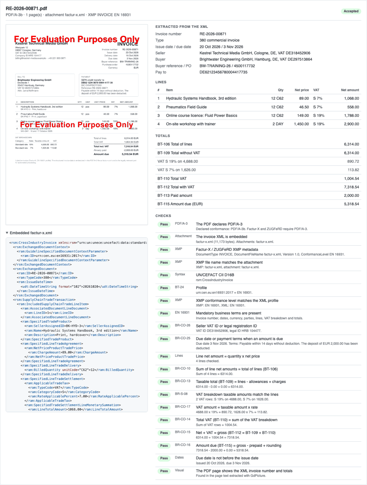
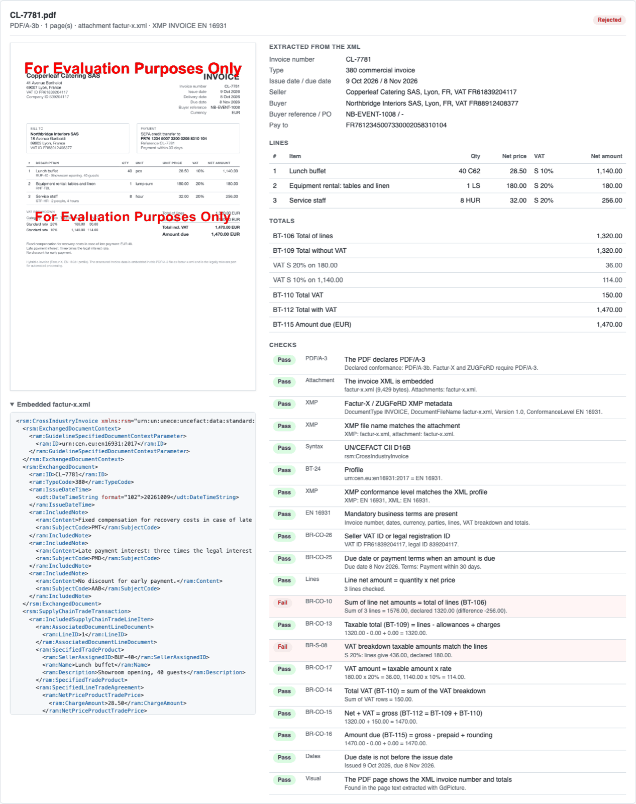
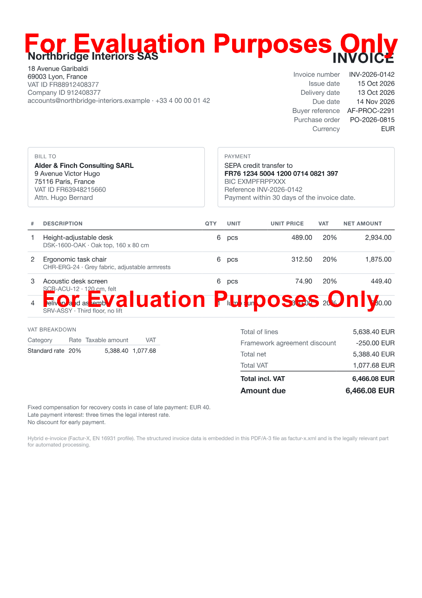

# Nutrient Factur-X E-Invoicing

A Nutrient.io demo that issues and checks hybrid e-invoices (Factur-X / ZUGFeRD, EN 16931 profile) with GdPicture.NET: a readable PDF/A-3b invoice that carries the structured invoice XML inside it.



Factur-X (France) and ZUGFeRD 2 (Germany) are the same hybrid format: a PDF/A-3 file for people, with a UN/CEFACT Cross Industry Invoice (CII) XML embedded as `factur-x.xml` for software. With the EN 16931 profile it meets the European e-invoicing standard, which is what the German B2B e-invoicing obligation and the French e-invoicing reform build on.

**Outgoing: issue an invoice**

1. **Invoice data.** One JSON file per invoice, as a billing system would export it. The totals are computed with the EN 16931 rules: line amounts, document allowances and charges, one VAT breakdown row per category and rate, amounts rounded to cents.
2. **XML.** The invoice is written as CII D16B with the guideline ID `urn:cen.eu:en16931:2017` (EN 16931 profile).
3. **Readable invoice.** An A4 HTML layout is converted to PDF with `GdPictureDocumentConverter` (Chrome engine).
4. **PDF/A-3b.** `GdPicturePDF.ConvertToPDFA(..., PdfConversionConformance.PDF_A_3b, ...)` makes the archival PDF that allows embedded files.
5. **Factur-X.** `GdPicturePDF.EmbedInvoiceData(xml, PdfInvoiceDataFormat.FacturX_1_0)` embeds the XML as `factur-x.xml` with everything the format needs: `AFRelationship /Data`, the `/AF` array of the document catalog, the `text/xml` MIME type, and the Factur-X PDF/A extension schema in the XMP metadata (`fx:DocumentType INVOICE`, `fx:DocumentFileName`, `fx:Version 1.0`, `fx:ConformanceLevel EN 16931`).
6. **Self-check.** The saved file is reopened and validated with `GdPicturePDF.CheckPDFAConformance(PdfValidationConformance.PDF_A_3b, ...)`.

**Incoming: check a received invoice**

7. **Read.** GdPicture opens the PDF and returns its PDF/A level, the list of embedded files, the invoice XML (`ExtractEmbeddedFile`), the XMP metadata (`GetMetadata`) and the visible text of each page (`GetPageText`).
8. **Check.** Container checks (PDF/A-3, attachment, XMP), required EN 16931 fields, and the arithmetic: line amounts, sum of lines, allowances, VAT per rate, net + VAT = gross, amount due. The XML totals are also searched in the page text, so a PDF that shows other figures than its XML is flagged.
9. **Report.** A summary per invoice in the console and an HTML report with the rendered page, the extracted data, every check and the embedded XML.

Everything runs locally. No cloud service is called.

## Prerequisites

- .NET SDK 8 or later
- Windows, macOS or Linux
- Google Chrome for the HTML to PDF step. GdPicture finds an installed Chrome. If there is none, the app downloads chrome-headless-shell (about 200 MB) to `.chrome/` on the first run. Only `create` and `demo` need it; reading and checking invoices does not.
- Optional, for the independent validation script: Java 17 or later and curl.

The project uses the cross-platform NuGet package `GdPicture.API` 14.4.11.1. (The `GdPicture` package is the Windows-only build.)

## Environment variables

Keys are only read from environment variables, never from code. Start from `.env.example`.

| Variable | Purpose | Default |
|---|---|---|
| `GDPICTURE_LICENSE_KEY` | GdPicture.NET license key | empty = evaluation mode |
| `CHROME_PATH` | Chrome or chrome-headless-shell executable for the HTML to PDF step | the Chrome GdPicture finds, else a download to `.chrome/` |

In evaluation mode GdPicture stamps a watermark on each PDF it writes (the HTML conversion, the PDF/A conversion and the final save each add one) and sets the document title to "For Evaluation Purposes Only". The invoice XML, the PDF/A structure and the checks are not affected. A rejected key falls back to evaluation mode with a message.

## Build and run

Run these from the repository root.

```bash
dotnet build EInvoicing.sln
```

```bash
set -a && source .env && set +a && dotnet run --project EInvoicing -- demo
```

`demo` issues the three sample invoices to `output/`, then checks them and the received sample in `samples/incoming/`, and writes `output/report.html`.

## Usage

| Command | Description |
|---|---|
| `demo` | Issue `samples/invoices/*.json`, then check the results and `samples/incoming/*.pdf` |
| `create [json or folder]...` | Invoice JSON to Factur-X PDF/A-3b, plus the XML next to it (default: `samples/invoices`) |
| `embed invoice.pdf invoice.xml` | An existing PDF invoice (from an ERP, for example) and its CII XML to a Factur-X PDF/A-3b |
| `read [pdf or folder]...` | Check received Factur-X / ZUGFeRD PDFs and write the HTML report (default: `output`) |
| `make-incoming-samples` | Regenerate `samples/incoming/` from `samples/incoming-data/` |

| Option | Description | Default |
|---|---|---|
| `-o`, `--output DIR` | Output folder | `output` |
| `-r`, `--report FILE` | HTML report | `<output>/report.html` |

```bash
dotnet run --project EInvoicing -- read samples/incoming/CL-7781.pdf
```

`read` exits with code 3 when at least one invoice fails a check, so it can gate an accounts payable workflow.

Output of `demo` (evaluation mode, Apple Silicon laptop, abridged):

```text
Outgoing: 3 invoice(s) to Factur-X (EN 16931) in output

  RE-2026-00871  Kestrel Technical Media GmbH -> Brightwater Engineering GmbH
    net 6,314.00 + VAT 1,004.54 = 7,318.54 EUR  (VAT rows: S 19%, S 7%)
    CII XML 1 ms | HTML to PDF 1054 ms | PDF/A-3b conversion 67 ms | Embed factur-x.xml 17 ms | PDF/A-3b validation 18 ms
    -> output/RE-2026-00871.pdf (1 page(s), 150 KB) and RE-2026-00871.factur-x.xml
    GdPicture PDF/A-3b validation: compliant

Incoming: 4 PDF(s) checked

  RE-2026-00871.pdf: Accepted
    PDF/A-3b, attachment factur-x.xml, XMP EN 16931
    RE-2026-00871 issued 2026-10-20 by Kestrel Technical Media GmbH (DE318452906) to Brightwater Engineering GmbH
    4 lines, net 6,314.00 + VAT 1,004.54 = gross 7,318.54, due 5,318.54 EUR by 2026-11-03
    20/20 checks passed

  CL-7781.pdf: Rejected
    PDF/A-3b, attachment factur-x.xml, XMP EN 16931
    CL-7781 issued 2026-10-09 by Copperleaf Catering SAS (FR61839204117) to Northbridge Interiors SAS
    3 lines, net 1,320.00 + VAT 150.00 = gross 1,470.00, due 1,470.00 EUR by 2026-11-08
    FAIL [BR-CO-10] Sum of line net amounts = total of lines (BT-106): Sum of 3 lines = 1576.00, declared 1320.00 (difference -256.00).
    FAIL [BR-S-08] VAT breakdown taxable amounts match the lines: S 20%: lines give 436.00, declared 180.00.
    18/20 checks passed
```

The received sample `CL-7781.pdf` is a valid PDF/A-3b with a well-formed Factur-X XML, but the supplier's system left line 3 out of its totals. Net + VAT = gross still adds up, so only a line-level check finds it:



The issued PDF is a normal invoice for people:



### Checks

| Group | Rule | Check |
|---|---|---|
| PDF | PDF/A-3 | The file declares PDF/A-3 (a, b or u) |
| PDF | Attachment | An invoice XML is embedded (`factur-x.xml`, `zugferd-invoice.xml`, `ZUGFeRD-invoice.xml` or `xrechnung.xml`) |
| PDF | XMP | Factur-X or ZUGFeRD XMP properties exist, and the file name they give is the attachment |
| Data | Syntax, BT-24 | The XML is CII D16B, the profile is known, and the XMP conformance level matches it |
| Required fields | EN 16931, BR-CO-26, BR-AE-02, BR-CO-25 | Number, dates, type, currency, parties and countries, lines, VAT breakdown and totals; seller VAT ID or legal ID; buyer VAT ID for reverse charge; due date or payment terms |
| Arithmetic | Lines, BR-CO-10 to BR-CO-17, BR-S-08 | Quantity x price per line, sum of lines, allowances and charges, taxable amount per VAT rate, VAT per rate, total VAT, net + VAT = gross, amount due |
| Consistency | Dates, Visual | Due date after issue date; invoice number, gross total and amount due appear in the page text |

Failures reject the invoice. Date and visual mismatches are warnings.

## Independent validation

`scripts/validate-with-mustang.sh` downloads the open-source [Mustang](https://www.mustangproject.org) validator (Apache License 2.0) from Maven Central to `tools/`, checks its SHA-1, and validates each PDF. Mustang checks the PDF/A part with veraPDF and the XML with the official EN 16931 and Factur-X schematron rules. The XML reports are kept in `output/validation/`.

```bash
scripts/validate-with-mustang.sh
```

Results for the files of this repository (Mustang 2.26.0):

```text
File                         PDF/A      XML      Overall  Errors
INV-2026-0142.pdf            valid      valid    valid
LLS-26-3307.pdf              valid      valid    valid
RE-2026-00871.pdf            valid      valid    valid
CL-7781.pdf                  valid      invalid  invalid  [BR-CO-10] [BR-S-08]
```

Mustang finds the same two errors in `CL-7781.pdf` as the demo. Its only other messages on the valid invoices are XRechnung and Peppol notices (business process, XRechnung specification ID), which do not apply to Factur-X. The standalone veraPDF 1.30.3 CLI also reports all four files as PDF/A-3b compliant.

The reader also accepts Factur-X files from other producers. A file built with Mustang's `combine` action (PDF/A-3u, `AFRelationship /Alternative`) passes all checks; a plain PDF without an embedded XML is rejected.

## Samples

| File | Content |
|---|---|
| `samples/invoices/inv-2026-0142-domestic-fr.json` | French furniture supplier: four lines, a framework discount, the late payment notes required in France |
| `samples/invoices/re-2026-00871-two-vat-rates-de.json` | German publisher: books at 7% and training at 19%, a deposit already paid |
| `samples/invoices/lls-26-3307-reverse-charge-be.json` | Belgian service company to a French customer: reverse charge (category AE, `VATEX-EU-AE`) |
| `samples/incoming-data/cl-7781-wrong-totals.json` | Data of the received sample, with totals declared by the supplier that leave out one line |
| `samples/incoming/CL-7781.pdf` | The received sample, generated from the JSON above |

All companies, people, addresses, VAT IDs and bank accounts are invented. IBANs use example bank codes and the `.example` mail domain is reserved. The JSON files are written by hand; `samples/incoming/CL-7781.pdf` is generated with:

```bash
dotnet run --project EInvoicing -- make-incoming-samples
```

## Invoice JSON

| Field | Business term |
|---|---|
| `number`, `typeCode`, `issueDate`, `dueDate`, `deliveryDate`, `currency` | BT-1, BT-3, BT-2, BT-9, BT-72, BT-5 |
| `buyerReference`, `orderReference`, `paymentTerms`, `notes` | BT-10, BT-13, BT-20, BG-1 |
| `seller`, `buyer` | Name, address, `vatId` (BT-31 / BT-48), `legalId` and `legalIdScheme` (BT-30 / BT-47), `electronicAddress` (BT-34 / BT-49), contact |
| `payment` | SEPA credit transfer: `iban` (BT-84), `bic` (BT-86), `accountName` |
| `lines[]` | `name`, `description`, `sellerItemId`, `quantity`, `unit` (UN/ECE Rec. 20), `unitPrice`, `vatCategory`, `vatRate` |
| `allowancesCharges[]` | Document-level discounts (`isCharge: false`) and charges, with their VAT category and rate |
| `vatExemptions[]` | Exemption reason and VATEX code per VAT category (AE, K, E, ...) |
| `prepaidAmount` | BT-113 |
| `declaredTotals` | Only for test data: totals used as given instead of computed |

## Project layout

| Path | Content |
|---|---|
| `EInvoicing/Program.cs` | Command line, license, Chrome setup |
| `EInvoicing/Invoice.cs` | Invoice data model and EN 16931 totals |
| `EInvoicing/CiiWriter.cs` | CII D16B XML, EN 16931 profile |
| `EInvoicing/InvoiceHtml.cs` | Readable invoice layout (HTML) |
| `EInvoicing/FacturXWriter.cs` | HTML to PDF, PDF/A-3b conversion, embedding and validation with GdPicture |
| `EInvoicing/FacturXReader.cs` | Reading a received PDF with GdPicture: PDF/A level, attachments, XMP, page text, page image |
| `EInvoicing/CiiReader.cs` | CII XML parsing |
| `EInvoicing/InvoiceChecks.cs` | The checks |
| `EInvoicing/ReportHtml.cs` | HTML report |
| `scripts/validate-with-mustang.sh` | Independent validation with Mustang |

## Limitations

- The checks are a readable subset of the EN 16931 rules, enough to accept or reject a received invoice with a clear reason. They do not replace the official validation artefacts; run Mustang or the KoSIT validator for a full validation.
- `create` writes the EN 16931 profile only. `read` recognises MINIMUM to EXTENDED and XRECHNUNG profiles, but its required-field checks follow EN 16931, so MINIMUM and BASIC WL files (which have no lines) fail them.
- ZUGFeRD 1.0 uses an older XML schema and is reported as not supported. Pure XML invoices (XRechnung, Peppol UBL) are not hybrid PDFs and are out of scope.
- No digital signature and no transmission (Peppol, French PDP, email).
- Do not set `InvariantGlobalization` in the project: with it, `ConvertToPDFA` returns `InvalidParameter`.
